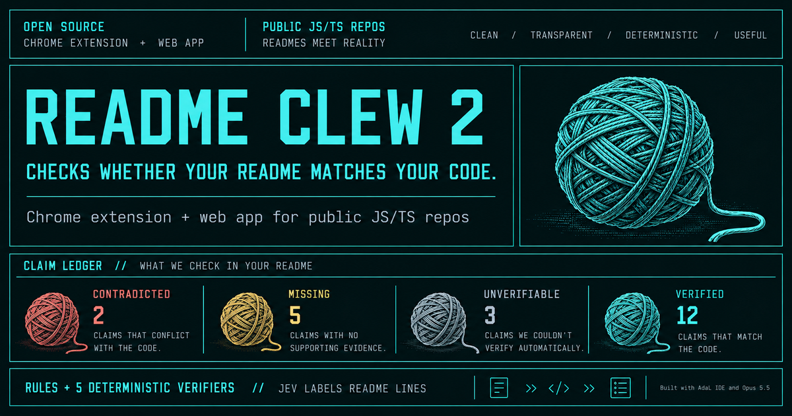
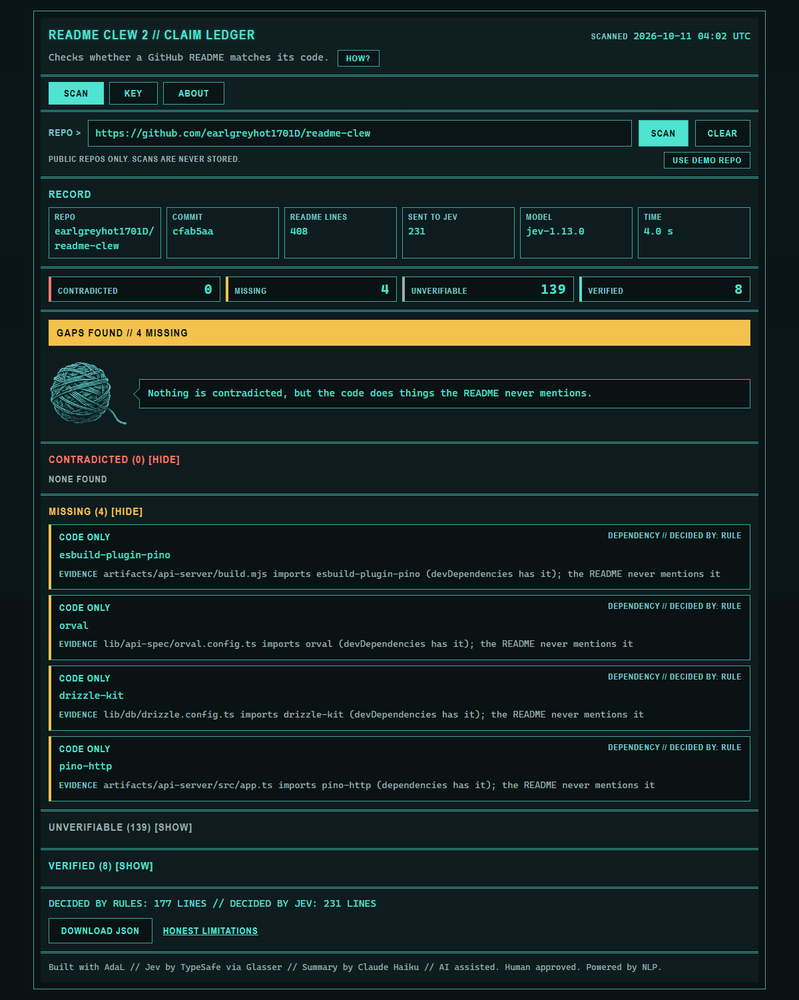
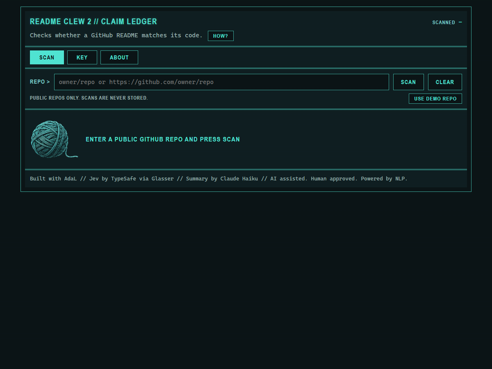
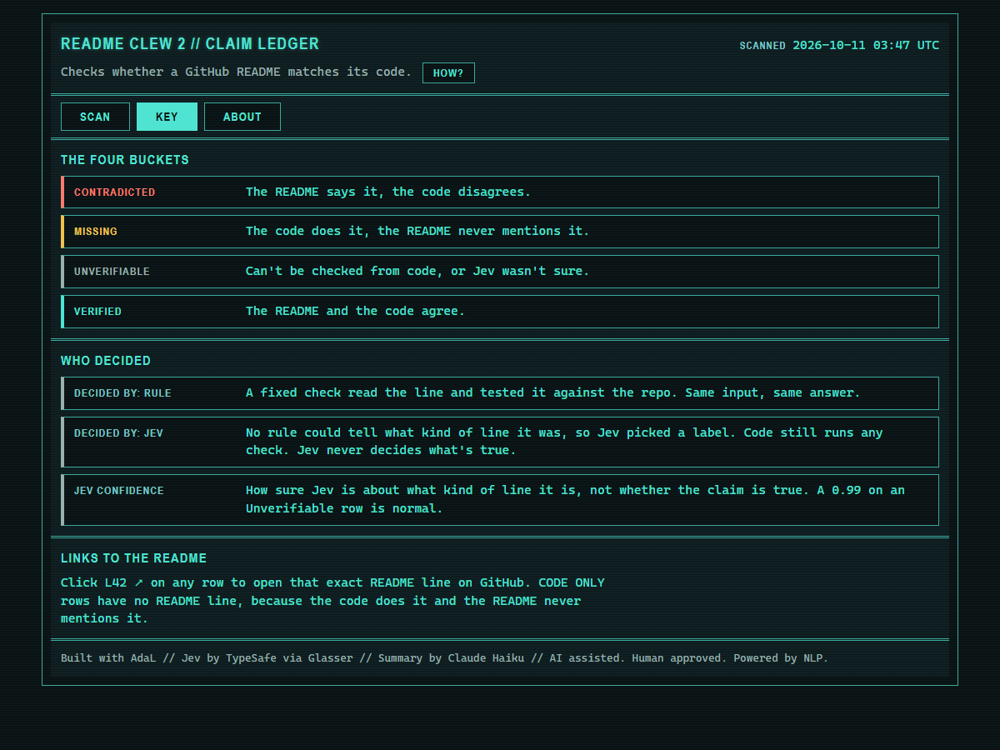
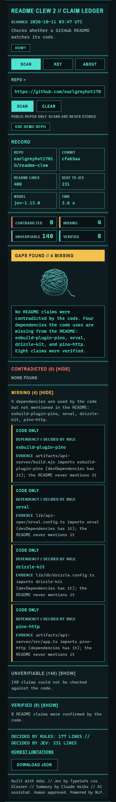
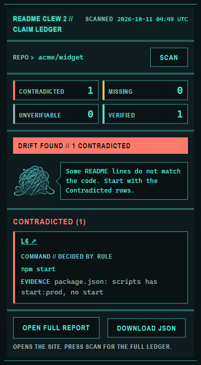

# README Clew 2



Checks whether a GitHub README matches its code.

**Live:** https://readme-clew-2.vercel.app

Paste a public JavaScript or TypeScript repo, press SCAN, and get a claim ledger: every checkable line of the README, what the code says about it, and who decided.

Built for the AdaL "What Would Jev Do?" hackathon, October 6 to 11, 2026.

**Why "clew"?** A clew (said like "clue") is a ball of thread. In the Greek myth, Ariadne gave Theseus a clew so he could follow it back out of the Labyrinth, and it's where the word "clue" comes from. README Clew follows the thread from each README line back to the code. It's also the name of the author's suite of civic tech tools.

---

## What it does

READMEs drift. A command gets renamed, an env var gets dropped, a package gets swapped, and the README keeps promising the old thing. README Clew 2 reads the README line by line and sorts each line into one of four buckets:

| Bucket | Means |
|---|---|
| **Contradicted** | The README says it, the code disagrees. Example: the README tells you to run a start script that `package.json` doesn't have |
| **Missing** | The code does it, the README never mentions it. Example: the code imports a package the README never names |
| **Unverifiable** | No code check can test it (opinions, scope notes, design claims), or Jev wasn't sure what kind of line it was |
| **Verified** | The README and the code agree |

Every row shows the exact README line (with a link to that line on GitHub), the code evidence, and **who decided: a rule or Jev.**

## Screenshots

**A real scan of README Clew v1** (this project's predecessor). No contradictions, four packages the code uses that the README never mentions:



| Home | Key | Phone |
|---|---|---|
|  |  |  |

**The Chrome extension popup,** shown with a sample report from the test fixtures (a README that says to run a start script the code doesn't have):



## Who it's for

Anyone who maintains or evaluates a JS/TS repo: open source maintainers before a release, hackathon judges reading a submission, and new contributors who want to know which parts of a README they can trust.

## From README Clew to README Clew 2

[README Clew](https://github.com/earlgreyhot1701D/readme-clew) (May 2026, Replit Buildathon) proved the idea. Its own README listed two honest limits:

1. Claude was *asked* to quote the README word for word. That was a prompt rule, not a code check.
2. Prose labels like "Frontend (Vite)" sometimes got pulled out as package names, which produced false Contradicted findings.

README Clew 2 is a rebuild from scratch, all new code, that fixes both by changing who decides what:

| Job | README Clew (v1) | README Clew 2 |
|---|---|---|
| Find claims in the README | Claude extracts and quotes | Code splits the README into lines and Jev labels them. The quote *is* the line, so word for word is guaranteed by code |
| Pick the real package, script or path name | Claude | Code finds candidates, Jev picks one, with confidence |
| Decide Verified or Contradicted | Five deterministic verifiers | Same five checks, rewritten. Still fully deterministic |
| Low certainty | Not reported | Goes to Unverifiable, never Contradicted |
| Summary | Claude Sonnet | Claude Haiku, from structured results only |
| Where it runs | Web page | Web page, Chrome extension and bookmarklet |

The demo repo is v1 itself, so the new version audits the old one. Its first scan of v1 was wrong in exactly the way v2 promises not to be, which is how the monorepo fix in "How it was built" happened.

## How it decides (and who doesn't)

The design rule: **models never decide what's true.**

1. **Rules first.** Code splits the README into lines and settles the obvious ones (headings, badges, blank lines) without any model.
2. **Jev labels.** For lines rules can't classify, [Jev](https://typesafe.ai) (TypeSafe's decision model, `jev-1.13.0`, called through [Glasser](https://glasser.ai)) picks what kind of claim the line is: a dependency, a command, an env var, a file or URL, or something no code check covers. Jev only picks labels.
3. **The 0.8 gate.** A line goes to a code check only if Jev is at least 0.8 confident it's one of those four checkable kinds. Below that, it's Unverifiable, tagged "Jev wasn't sure."
4. **Five deterministic verifiers decide.** Dependencies, commands, env vars, file and URL references, and code-vs-package coverage. They read `package.json`, the file tree and the source. Same input, same answer.
5. **Claude Haiku explains.** Haiku writes the short summary from the structured results only (counts, claim types and names). It never sees the README lines themselves and never decides a bucket. If Haiku fails, the report is still complete.

When in doubt, README Clew 2 says "can't tell." Calling a correct README wrong is the one mistake the design works hardest to avoid.

### Where Jev matters

Jev is what lets this work on real READMEs, which are mostly prose. Regex finds candidate names; Jev decides whether a line like "Run the dev server" is a command claim worth checking, and how sure it is. Its calibrated confidence is what the 0.8 gate stands on.

Measured on a held-out set of 32 README lines, frozen configuration, run twice:

| Measure | Run 1 | Run 2 |
|---|---|---|
| Wrong routes passing the 0.8 gate | 0 | 0 |
| False Contradicted (end-to-end scan) | 0 | 0 |
| Real drift found | 3 of 3 | 3 of 3 |

Comparing the two runs, 0 of the 32 lines changed label.

The sample is small, so this supports "safe enough to ship," not a measured error rate. Full numbers and caveats are in [LEDGER.md](LEDGER.md).

Cost per scan is about a penny: roughly $0.009 for Jev and $0.0005 for Haiku. Glasser's own run and balance history for the build is in [evaluation/usage_report.md](evaluation/usage_report.md).

## Try it

### Why a website, an extension and a bookmarklet?

Same scan, same results, three ways to reach it, because people check a README from different places:

| Use | Best when | Why it exists |
|---|---|---|
| **Live page** | You want the full ledger, or you're on a phone | No install. Shareable links with the repo filled in. Shows every bucket, the KEY and the ABOUT tab |
| **Chrome extension** | You're already looking at the repo on GitHub | One click from the page you're on, no copy and paste. Shows the counts and the top problems, with a link to the full ledger |
| **Bookmarklet** | You can't or won't install an extension (another browser, or a work computer that blocks extensions) | Nothing to install. It only opens the live page with the repo filled in |

All three call the same scan API and share the same display code, so a repo gets the same answer wherever you check it.

### Live page (no install)

1. Open https://readme-clew-2.vercel.app
2. Press **USE DEMO REPO**, then **SCAN**. The demo is README Clew v1, this project's predecessor.
3. Open **KEY** for what each bucket and label means, and **ABOUT** for limits and links.

Deep links work too: `https://readme-clew-2.vercel.app/?repo=owner/name` fills in the repo. The page never scans until you press SCAN.

### Chrome extension (load unpacked)

1. Download the extension ZIP (version 0.1.0) from this repo's [Releases](https://github.com/earlgreyhot1701D/readme-clew-2/releases) and unzip it.
2. Open `chrome://extensions` and turn on **Developer mode**.
3. Click **Load unpacked** and choose the unzipped folder.
4. Open any public JS/TS repo on GitHub, click the clew icon, and press **SCAN**.

The extension asks for `activeTab` and the one API address only. It reads the current tab's URL when you click, and nothing else.

### Bookmarklet (any browser)

Drag the bookmarklet from the **ABOUT** tab to your bookmarks bar. On a GitHub repo page, click it to open the live page with that repo filled in. It only navigates. It never reads the page or sends anything. Source: [bookmarklet/bookmarklet.js](bookmarklet/bookmarklet.js).

## Honest limitations

- **JavaScript and TypeScript only.** Every check needs a source of truth inside the repo, and in JS/TS that's one file, `package.json`, which lists both the packages and the commands. Python spreads the same facts across several optional files. Other languages are planned, not built. A repo with no `package.json` gets a clear "not a JS/TS repo" message, and no model is called.
- **Most lines end up Unverifiable.** That's expected. Most README text is prose that no code check can test. Unverifiable means "can't tell," not "wrong."
- **Monorepos:** reads the pnpm workspace file and the workspaces field in `package.json`, with simple folder patterns only (one level of wildcard, or an exact folder), up to 30 workspaces. Beyond that, Missing turns into Unverifiable. A recursive pnpm command counts as verified if any one workspace has that script.
- **Example, demo, test, fixture and docs folders** are skipped when looking for Missing packages, because they usually have their own `package.json`.
- **Size:** READMEs over 50 KB are cut, and at most 20 source files are read per scan.
- **Env vars are only called Contradicted when the whole repo was read.** If a scan hit the 20-file limit, or the repo has config files whose text wasn't fetched (database schemas, CI and Docker files), a missing env var comes back Unverifiable instead. `PORT`, `NODE_ENV`, `CI` and `HOST` are always Unverifiable, because platforms set them.
- **Build output isn't checked.** A README that points at `dist/`, `build/`, `out/` or similar gets Unverifiable, because those files are created by the build and aren't committed.
- **Labels can drift by a line.** The same README scanned twice can move one borderline line between buckets. The 0.8 gate keeps that drift away from Contradicted.
- **No badge.** A live README badge would re-run a scan, and bill the owner, every time someone viewed it. Without storage there's no safe way to cache it, so it's not built.
- **The summary can be unavailable.** If Haiku times out or fails, the report shows a fixed line instead. Everything else still works.

## Privacy: no database, nothing about you

README Clew 2 is built so there is nothing about you or your scan to lose.

- **Scans are never stored.** There is no database and no account. The report exists in your browser tab until you leave or press CLEAR.
- **No cookies, no tracking of what you scan.** Page views are counted anonymously through Vercel Analytics. Which repos people scan is never recorded.
- **Logs hold counts and timing only.** Never README text, code, or model output.
- **The models see as little as possible.** Jev gets the README so it can label each line. Those calls run through Glasser, which keeps a record of each run under the project owner's account, as API providers do. Public README text only, never anything about you. Claude Haiku gets only counts, claim types and names, never the README lines themselves, so a README can't talk to the summary model.
- **Public repos only.** Private or missing repos get "repo not found or not public."
- **Keys stay on the server.** `GLASSER_API_KEY`, `ANTHROPIC_API_KEY` and `GITHUB_TOKEN` live only in server-side environment variables. Never in the page, the extension or this repo.
- **Defensive by default.** All repo text is rendered with `textContent`, input is validated in the page and again on the server, and the scan API is rate-limited.

## Your report, your file: DOWNLOAD JSON

Since nothing is stored, the report is yours to keep. **DOWNLOAD JSON** (on the page and in the extension) saves the full report to your machine as a file named after the repo and commit. It's built in your browser. Nothing is sent anywhere.

The file holds every finding with its README line, code evidence, bucket, who decided and Jev's confidence, plus a **scan receipt**:

| Receipt field | What it lets you do |
|---|---|
| Repo and commit | Know exactly which version of the code was checked |
| README fingerprint (SHA-256) | Prove which README text was checked, without storing the text |
| Report fingerprint (SHA-256) | Check later that the report wasn't edited |
| Lines decided by rules vs by Jev | See how much was deterministic |
| Calls and step timing | See how many model calls the scan made and how long each step took |

No model writes any part of the receipt. Ways to use the file: attach it to a pull request before a release, keep it as a before-and-after record when you fix your README, or hand it to a reviewer as evidence.

## Testing

**473 tests, all offline.** `npm test` runs them with Node's built-in test runner. No network and no keys: Jev's answers come from recorded fixtures, so the suite gives the same result every time.

The tests that matter most guard the promise that a correct README is never called wrong:

| Guard | What it proves |
|---|---|
| The five verifiers | Each check gives the right bucket on known cases, including drift it must catch |
| The 0.8 gate | Lines Jev isn't sure about go to Unverifiable, never to a verifier |
| The prose guard | A name that only appears in prose can never be marked Contradicted, however confident Jev is |
| A confidently wrong Jev | A fixture where Jev mislabels a line with high confidence still produces no false Contradicted |
| No false accusations from what wasn't read | An env var read in a file past the 20-file limit, and a command pointing at build output, both come back Unverifiable, not Contradicted |
| Monorepo regressions | The real layouts of README Clew v1 and polka, the two cases that fooled earlier versions, stay fixed |
| Not a JS/TS repo | The scan stops before Jev is ever called |
| Prompt injection | A README with planted instructions: the text becomes the quoted line but never reaches the summary model |
| The product promise | Every fixture end to end, twice: once normally, once with Jev and Haiku forced to fail. The report still renders, with an honest error or no summary |
| Safe rendering | The build fails if any page or extension file uses `innerHTML` or `eval` |

**Every new guard was shown failing once** (the code was broken on purpose, the test went red, the code was restored), so no test passes by accident.

**Beyond the suite:**
- **A live Jev evaluation** on 64 hand-labeled lines from four real READMEs and one made-up README of hard cases, tuned on half and checked on the held-out half (results under "Where Jev matters").
- **Real-browser QA** at desktop and phone widths at the end of each build block, in Chrome with the production security headers.
- **Live scans** of real repos, which is how both monorepo bugs were found.
- **The self-scan:** README Clew 2 scanned its own README before submission. 0 Contradicted.

Honest note: 473 is more than a five-day build needed. Many tests re-prove page wiring that the browser checks already cover. The guards in the table above are the ones worth keeping.

## How it was built

Built in five days in the [AdaL](https://adalagent.ai) desktop app, block by block, with propose-first prompts and an `AGENTS.md` it read every turn. Claude wrote the PRD, the architecture and the docs, and reviewed AdaL's work at each checkpoint.

- **AdaL** wrote the code and tests, ran the Jev evaluation, deployed to Vercel, and drove a real browser for QA. What stood out:
  - **Fast.** In plan mode it proposed and confirmed plans so quickly that a prompt was often done before I got back to my desk.
  - **It followed the rules it was given.** Propose first, one block at a time, no edits outside the named files, a QA checkpoint at the end of every block.
  - **It found real bugs, not just the ones it was told about.** Glasser's 100-question limit per call (only the live API says so), a timer that let tests quietly cancel instead of fail, a state trimmer that measured the wrong text, and two layout bugs that only a real browser showed.
  - **It turns capabilities on by itself when a task needs them.** It switched on its browser tool to screenshot and time the UI without being asked.
  - **The team behind it showed up.** They fixed the Glasser connector the same day I reported it, and granted a credit when I hit the Pro plan's weekly limit.
- **Glasser** is how Jev is called: plain Glasser runs (`POST /v1/runs`), one run per batch of up to 100 questions. Failed runs cost nothing, and every run reports its exact charge. The build's usage report is generated from Glasser's run and balance history.
- **Workflows and Sandboxes:** not used.

Things that went wrong, kept on the record:

- The first real test, scanning README Clew v1, falsely called three lines Contradicted. v1 is a pnpm monorepo in folders the workspace finder didn't know, and pnpm's filter option was read as a script name. Fixed and saved as a regression test.
- A second live test found 14 Missing packages that all came from an examples folder with its own package file. Fixed the same way.
- Reading the verifier code one last time before submitting turned up two more ways to accuse a correct README: env vars read in files the scan never opened, and build output that is never committed. Both now come back Unverifiable.
- The test suite grew to 473 tests in five days, more than it needed. See "Testing" for which ones matter.

The decision log is [LEDGER.md](LEDGER.md). The block-by-block log is [BUILD-LOG.md](BUILD-LOG.md). The spec is [PRD.md](PRD.md).

## For developers

Requires Node.js 22 or newer. No runtime dependencies.

```
npm test
```

Runs the full suite offline with recorded Jev answers. No network, no keys needed.

| Folder | Holds |
|---|---|
| `api/` | The Vercel function for scans |
| `lib/` | One file per job: line splitting, candidates, Jev client, gate, buckets, summary, receipt |
| `lib/verifiers/` | The five deterministic checks |
| `web/` | The live page, plain HTML and JavaScript, no build step |
| `extension/` | The Chrome popup (Manifest V3), sharing code synced from `web/` |
| `bookmarklet/` | Bookmarklet source |
| `fixtures/` | Sample READMEs, recorded Jev answers, expected reports |
| `evaluation/` | The Jev evaluation runner, results and usage report |

To run your own copy, set `GLASSER_API_KEY`, `ANTHROPIC_API_KEY` and `GITHUB_TOKEN` as environment variables on Vercel and deploy the repo. The site is served from `web/`.

## Credits

### How we use Jev

Swift (Major League Hacking), ["I got Jev to zero mistakes. I'm still using Flash-Lite."](https://dev.to/theycallmeswift/i-got-jev-to-zero-mistakes-im-still-using-flash-lite-2mo7), DEV Community, October 8, 2026.

MLH measured Jev on a routing job close to ours: deciding which deterministic checker can verify a plain-English claim. Their findings shaped how README Clew 2 asks Jev questions and when it trusts the answers:

- **The two mistakes aren't equal.** Marking a line Unverifiable costs a little coverage. Sending a line to the wrong verifier can produce a false "Contradicted," which costs your trust. So when Jev isn't sure, README Clew 2 says "can't tell."
- **Describe the verifier, not the line.** Jev answers the question you wrote, literally. Our label criteria describe what each verifier checks and what it can't see, instead of what a README line looks like.
- **One test question.** "Imagine the verifier finds this name in the code. Would that prove this line is a true claim about this repo?" If not, the line isn't sent to a verifier.
- **No worked examples in Jev's criteria.** In MLH's tests, adding examples made Jev's dangerous mistakes worse.
- **Count mistakes per line, not per run.** Jev's errors tend to repeat on the same line, which a better question can fix.
- **A 0.8 confidence bar,** checked on half our test lines after tuning on the other half.

### Further reading

DigitalOcean, ["Jev: an AI model that can't write a sentence"](https://dev.to/digitalocean/jev-an-ai-model-that-cant-write-a-sentence-3cj), DEV Community, October 9, 2026. Where we first saw Jev's input limits. The limits the code enforces come from TypeSafe's model page.

### Art

The clew mascot and the social card were generated with ChatGPT by the author, then cut out and sized by Claude.

### Thanks

To the AdaL team, who answered fast every time: they fixed the Glasser connector the same day I reported it, and granted a credit when I hit the Pro plan's weekly limit mid-build so I could finish.

### Built with

AdaL, Jev by TypeSafe via Glasser, Claude Haiku, Vercel. A [Clew Labs](https://clewlabs.org) project.

## License

Apache 2.0. See [LICENSE](LICENSE).

---

AI assisted. Human approved. Powered by NLP.
